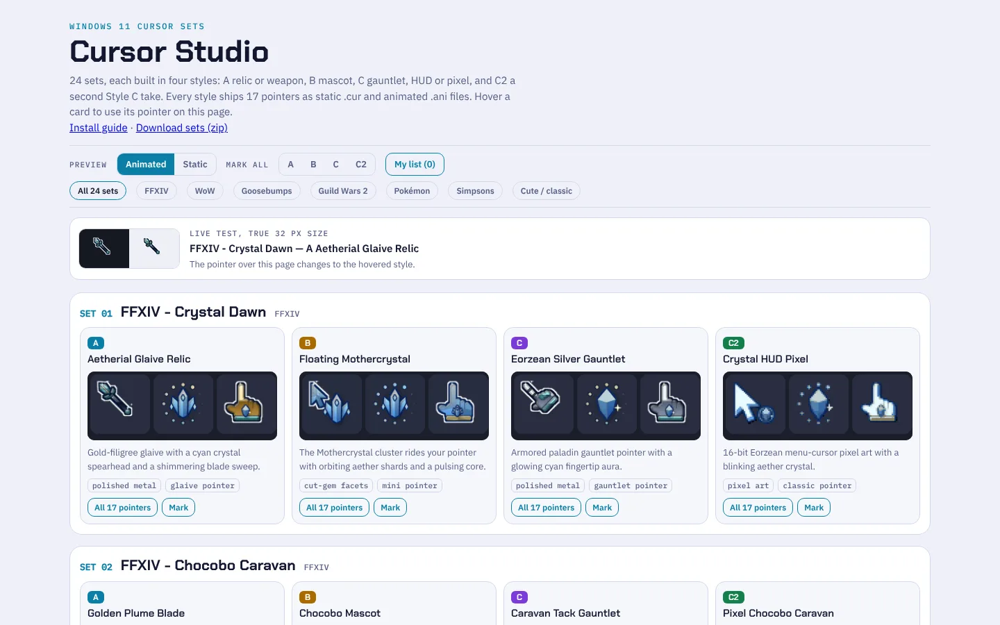
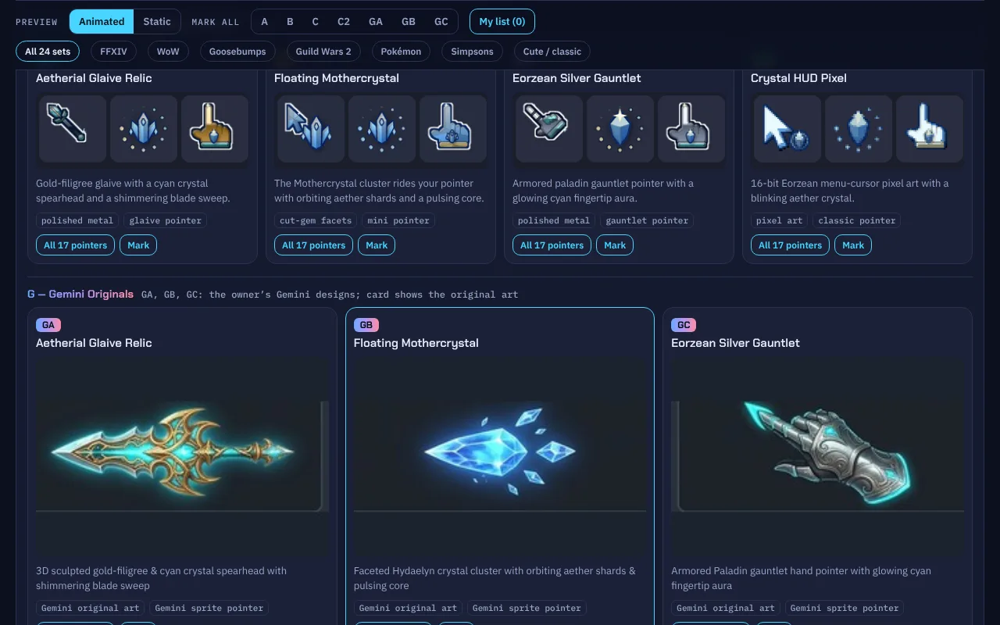
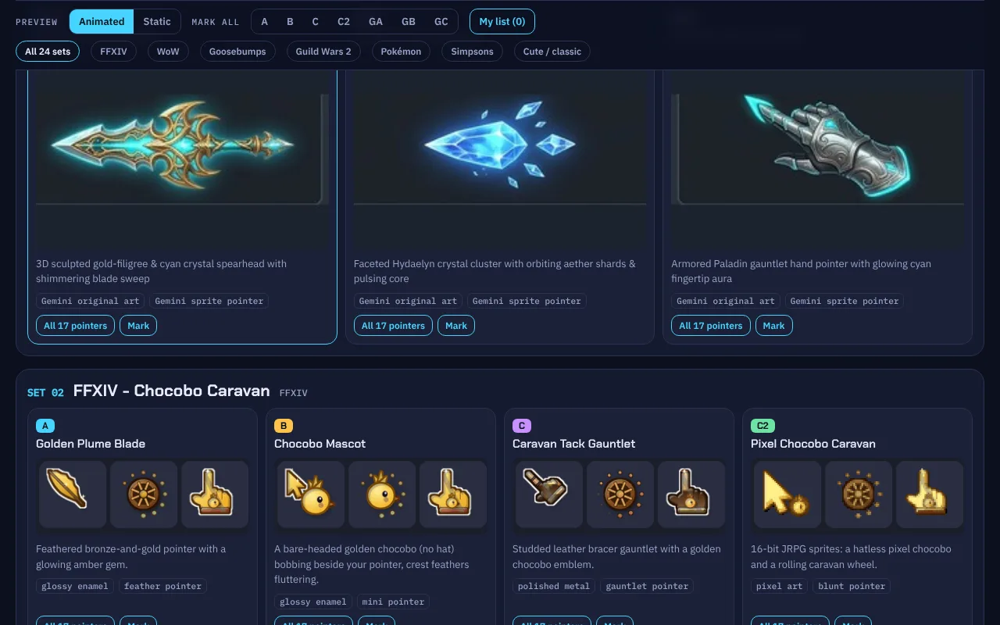
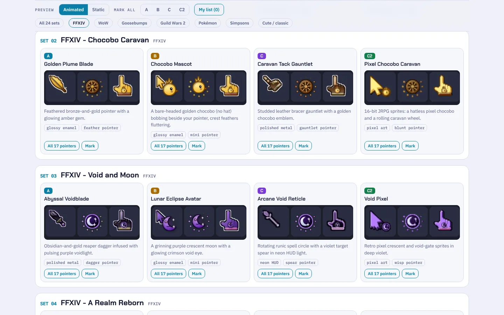
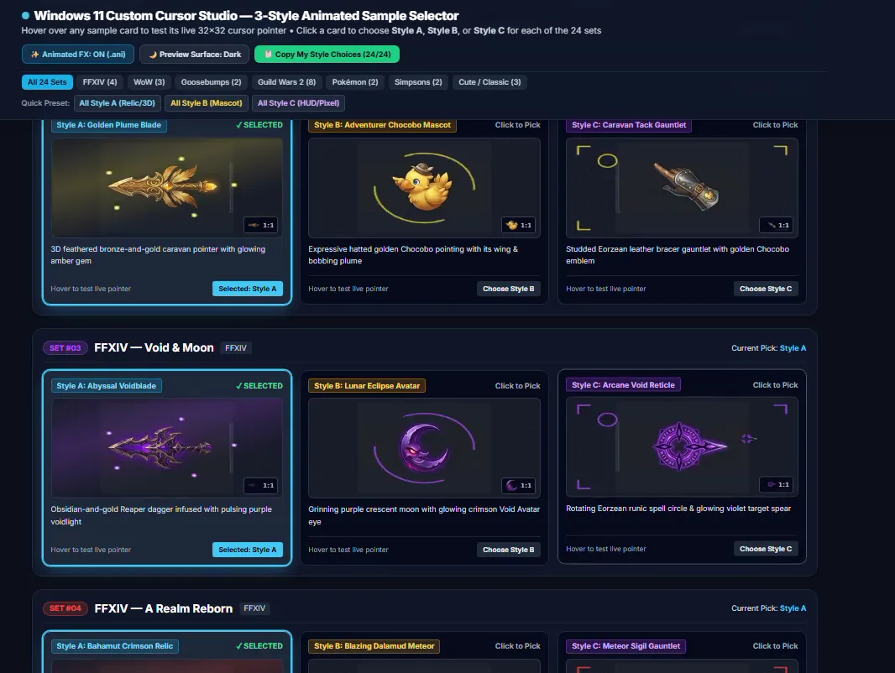
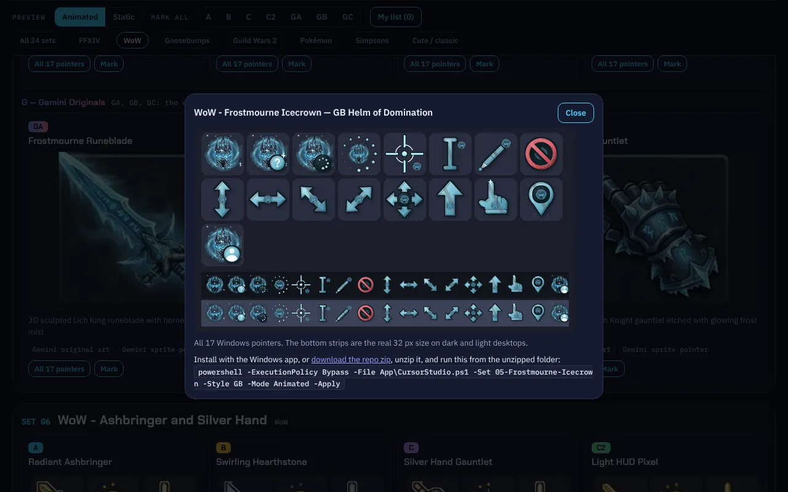

# Cursor Studio

[**▶ Live demo: cursors.caseyshingledecker.com**](https://cursors.caseyshingledecker.com/) - hover any card to try that cursor in your browser (dark theme).

**24 Windows 11 cursor sets x 7 styles** (168 styles) - static `.cur` and animated `.ani`, a dark-theme browser selector, a dark-mode installer, and the generator that renders all 5,712 cursor files. Everything (selector, install guide, previews, installer) is dark themed.

> **Status:** built and checked on Linux. The files are validated structurally and the installer logic is unit-tested against a registry stub, but the cursors and the WinForms installer have **not yet been tested on a live Windows desktop**.

## Screenshots and video

| | |
|:--:|:--:|
|  |  |
| Cursor Studio page with the Animated preview toggle, a live test pointer and the FFXIV Crystal Dawn set cards. | Crystal Dawn set cards in the Animated preview (dark theme), each showing three pointer thumbnails in styles A, B, C and C2. |
|  |  |
| The Gemini Originals row (GA, GB, GC) of Crystal Dawn: the cards show the original Gemini art and the live 32 px pointer on hover. | Filtered to WoW: the Gemini Originals of Frostmourne Icecrown, then the procedural styles of Ashbringer and Silver Hand. |

### Video

*Full walkthrough (2 min)*

*Click the poster to open the short screen recording (docs/media/clip.mp4).*

Every set comes in seven styles:
- **A**: relic or weapon.
- **B**: mascot.
- **C**: gauntlet, HUD or pixel.
- **C2**: a second Style C take.
- **GA / GB / GC - Gemini Originals**: the owner's Gemini-designed cursor art (Gemini's A, B and C designs) as full 17-pointer styles. The Gemini sprite is the Normal Select pointer; the other roles combine it with the engine's busy ring, I-beam, resize arrows, link hand and so on. 32 px comes from the Gemini sprite, 48/64 px from a clean cutout of the card art (or an upscaled sprite where the cutout did not match). Animated versions pulse an accent glow with shimmer or sparkles. Hotspots come from the sprite tip. The selector cards for these styles show the original Gemini card art.

Each style ships all 17 Windows pointers as **static `.cur`** and **animated `.ani`** files.

| # | Set | # | Set |
|---|---|---|---|
| 01 | FFXIV - Crystal Dawn | 13 | GW2 - Canach |
| 02 | FFXIV - Chocobo Caravan | 14 | GW2 - Palawa Joko |
| 03 | FFXIV - Void and Moon | 15 | GW2 - Tyrian Legends Ensemble |
| 04 | FFXIV - A Realm Reborn | 16 | GW2 - Blish and Taimi Magitech |
| 05 | WoW - Frostmourne Icecrown | 17 | GW2 - Canach, Joko and Tybalt |
| 06 | WoW - Ashbringer and Silver Hand | 18 | Pokemon - Kanto Companions |
| 07 | WoW - Dalaran Arcane and Emerald Dream | 19 | Pokemon - Ghost Parade |
| 08 | Goosebumps - Monster Blood | 20 | Simpsons - Springfield Donuts |
| 09 | Goosebumps - Revenge of the Lawn Gnomes | 21 | Simpsons - Nuclear Nightshift |
| 10 | GW2 - Blish | 22 | Sanrio Friends Remastered |
| 11 | GW2 - Tybalt Leftpaw | 23 | Strawberry Dream Bakery |
| 12 | GW2 - Taimi and Scruffy 2.0 | 24 | Spooky Paws |

## Use
- **Browse and test:** open `Selector.html`. Hover a card to use that pointer on the page.
- **Install on Windows 11:** double-click `App/Launch-CursorStudio.bat`. Pick a set, a style, and Animated or Static, then press Apply Now. No admin rights needed.
- **Picture guide:** `Docs/Install-Guide.html` (also `.png` and `.pdf`, dark styled).
- **Manual:** every `Static/` and `Animated/` folder holds the 17 files plus an `Install.inf`.
- **CLI:** `powershell -ExecutionPolicy Bypass -File App/CursorStudio.ps1 -Set 01-Crystal-Dawn -Style A -Mode Animated -Apply`

## Revise or rebuild
See `HANDOFF.md`. `python3 Generator/v2/package.py` makes the full exportable zip. The Gemini styles are built by `Generator/v2/build_gem.py` from the sources in `Generator/v2/gemini_src/`.

## Disclaimer
Independent, personal-use fan project. All artwork is original and procedurally drawn by code; no game or show assets are included. Franchise names (Final Fantasy XIV, World of Warcraft, Goosebumps, Guild Wars 2, Pokemon, The Simpsons, Sanrio) are trademarks of their owners, who do not endorse this project.

## Credits
Built by Casey Shingledecker with Claude Code. Set roster and A/B/C style concepts adapted from a Gemini design proposal. Original designs by Gemini (Argon) from the owner's design session (the GA, GB and GC styles).

## License

Copyright (c) 2026 Casey Shingledecker. All rights reserved. Source-available for viewing and for personal, non-commercial running only; this is not open source. See [LICENSE](LICENSE). See also [NOTICE.md](NOTICE.md). Other people's material keeps its own license.
